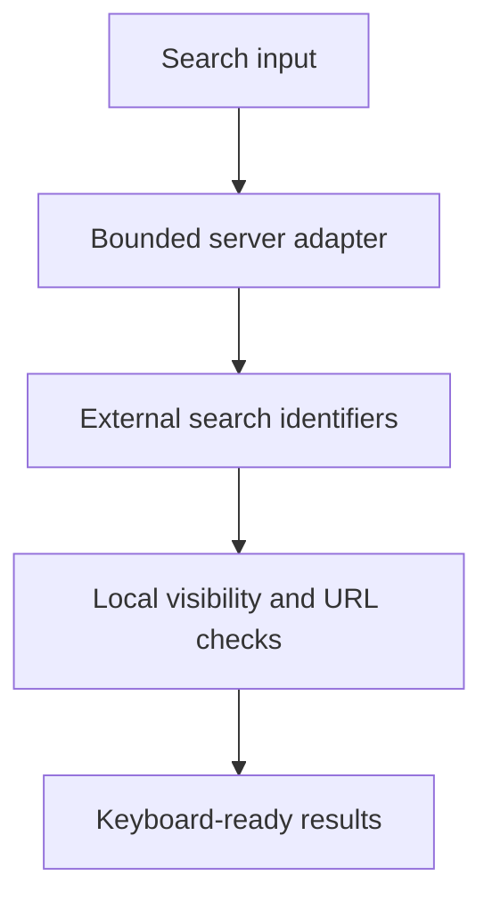

# Secure WordPress Search Autocomplete

A server-mediated product autocomplete that treats external search results as identifiers, then resolves display content through local publication and origin policies.

**Technical showcase · Documentation only · Anonymized**

WordPress | WooCommerce | PHP | JavaScript | AJAX | Node.js

## Engineering problem

Search infrastructure can return stale or unsuitable records. The dropdown must also handle rapid typing, canceled requests and keyboard navigation without rendering an older response over a newer query.

## Implementation scope

- Added a staging-gated server adapter with request validation, query bounds and constrained fallback behavior.
- Resolved titles, links and thumbnails from locally published products instead of trusting remote display fields.
- Applied same-origin media and URL policies and used textContent for dynamic result text.
- Implemented debouncing, request cancellation and response sequence checks.
- Covered server policy, keyboard navigation, Escape behavior, product visibility and result metadata in PHP and JavaScript regression suites.

## Architecture at a glance

The following is an illustrative technical flow, not a client screenshot or a deployment topology.

## Evidence and delivery boundary

Staging implementation; not a production-launch claim.

The implementation includes local PHP and Node regression coverage and records a provisional staging deployment. Formal acceptance and remaining hosting, styling and result-quality checks are not represented as complete.

## Read more

- [Engineering decisions](docs/engineering.md)
- [Scope and evidence boundaries](docs/scope.md)

> This repository describes verified implementation work at a technical level. Original source, identities, business data and visual assets are intentionally omitted. It is not an installable application or a claim that the original private implementation is open source.
